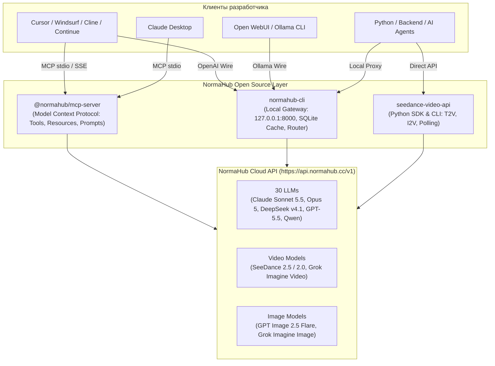

<p align="center">
  <a href="https://normahub.cc">
    
  </a>
</p>

<h1 align="center">NormaHub Developer Ecosystem</h1>

<p align="center">
  Прямой доступ к 30 текстовым, визуальным и видео-моделям (Claude, GPT, DeepSeek, SeeDance Video) через единый API без необходимости VPN.
</p>

<p align="center">
  <a href="https://normahub.cc"></a>
  <a href="https://www.npmjs.com/package/@normahub/mcp-server"></a>
  <a href="https://github.com/normahubcc/mcp-server-normahub"></a>
  <a href="https://python.org"></a>
  <a href="https://opensource.org/licenses/MIT"></a>
</p>

---

## Архитектура экосистемы



---

## Основные репозитории

| Репозиторий | Описание | Стек | Быстрый запуск |
|---|---|---|---|
| [**`mcp-server-normahub`**](https://github.com/normahubcc/mcp-server-normahub) | Официальный MCP-сервер для подключения к Claude Desktop, Cursor и AI-агентам. Инструменты генерации текста, картинок и видео. | TypeScript, MCP 1.0, Stdio & SSE | `npx -y @normahub/mcp-server` |
| [**`normahub-cli`**](https://github.com/normahubcc/normahub-cli) | Локальный шлюз (gateway) с эмуляцией OpenAI и Ollama API, дедупликацией в SQLite и авто-настройкой конфигов IDE. | Python 3.9+ (Zero-deps), SQLite | `normahub start` |
| [**`seedance-video-api-python`**](https://github.com/normahubcc/seedance-video-api-python) | Python SDK и CLI для генерации видео через ByteDance SeeDance 2.5 / 2.0 и xAI Grok Video (Text-to-Video и Image-to-Video). | Python 3.9+ (Zero-deps), asyncio | `seedance "Промпт" -o video.mp4` |
| [**`code-review-action`**](https://github.com/normahubcc/code-review-action) | Автоматизированный GitHub Action для проведения код-ревью в Pull Request с защитой от спама и блокировкой уязвимостей. | Node.js (Zero-deps), GitHub Action | `uses: normahubcc/code-review-action@v1` |

---

## Поддерживаемые модели

### Языковые модели и рассуждения (LLM)
- **Claude:** `claude-sonnet-5-5`, `claude-opus-5`
- **DeepSeek:** `deepseek-v4.1-flash`, `deepseek-chat`
- **OpenAI:** `gpt-5.5`, `gpt-6-sol`
- **Z.ai:** `glm-5.3-flash`
- **Alibaba:** `qwen-2.5-coder-32b`, `qwen-2.5-72b`

### Генерация видео (Text-to-Video & Image-to-Video)
- `seedance-2.5` — 1080p кинематографичное видео (ByteDance / SeeDance)
- `seedance-2.0` / `seedance-2.0-fast` — генерация HD-видео и превью
- `grok-imagine-video-1.5` — стилизованное видео от xAI

### Генерация изображений
- `gpt-image-2.5-flare`
- `grok-imagine-image-2.0`

Полный актуальный список моделей с тарифами доступен на [normahub.cc/models](https://normahub.cc/models).

---

## Быстрый старт (30 секунд)

### 1. Подключение к Cursor / Claude Desktop через MCP
```json
{
  "mcpServers": {
    "normahub": {
      "command": "npx",
      "args": ["-y", "@normahub/mcp-server"],
      "env": {
        "NORMAHUB_API_KEY": "nr_hub_..."
      }
    }
  }
}
```

### 2. Запуск локального Gateway
```bash
pip install normahub-cli
export NORMAHUB_API_KEY="nr_hub_..."
normahub start
normahub setup cursor
```

### 3. Генерация видео из Python
```python
from seedance import NormaVideoClient

client = NormaVideoClient(api_key="nr_hub_...")
client.generate_and_download(
    prompt="Футуристичный неоновый город, отражение в мокром асфальте",
    model="seedance-2.5",
    output_path="city.mp4"
)
```

---

## Сообщество и контакты

- 🌐 Официальный портал: [normahub.cc](https://normahub.cc)
- 📚 Документация API: [api.normahub.cc/docs](https://api.normahub.cc/docs)
- 💬 Техническая поддержка: [manager@normahub.cc](mailto:manager@normahub.cc)
- 📄 Лицензия: Все open-source компоненты распространяются под лицензией MIT.
